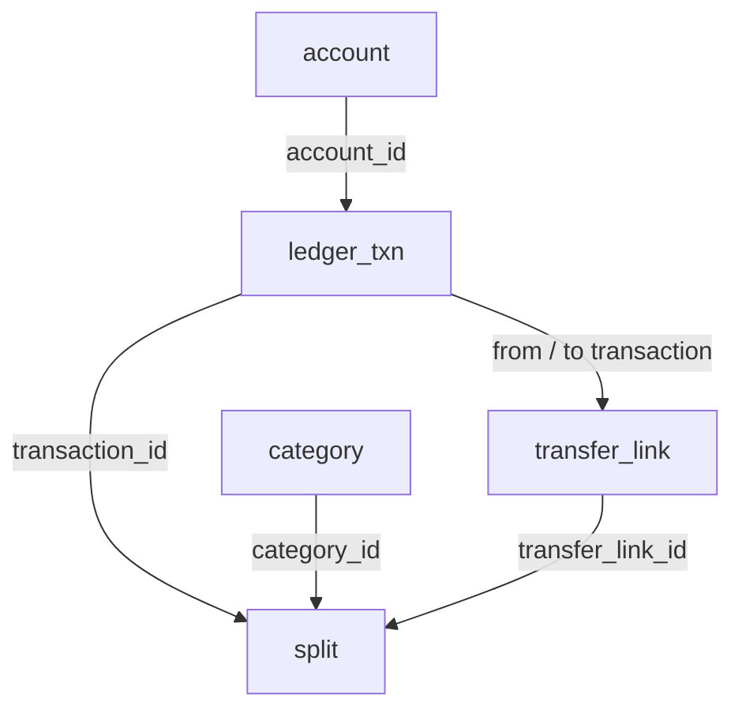

# PerFin database structure

SQLite is the current local backend; Access is an optional Windows backend and future portability target. Both use the same logical entities and repository commands. Native Access/desktop Excel acceptance is a release requirement, not a prerequisite for continuing development.

Open [the offline table explorer](model.html) for clickable tables, incoming/outgoing links and all column definitions. The [machine-readable inventory](schema-inventory.json) is generated from the canonical DDL, not a populated database.

## Read the structure in this order

1. **Accounts and categories** define where money belongs and how flows are classified.
2. **Batches and staging rows** retain the original file/row and human decisions. Staging does not change balances.
3. **Ledger transactions and splits** record approved activity atomically. Split amounts must total the transaction.
4. **Transfers** connect two equal-and-opposite transactions on different same-currency accounts; they are not spending twice.
5. **Statements and reconciliations** compare the ledger against external evidence without overwriting history.
6. **Terms and valuations** support payoff planning and dated net worth. Reports and workbooks are read models.
7. **Commands and audits** preserve replay protection, revisions and before/after values in the same transaction.

## Core relationships



Arrows run from referenced parent to referencing child. Most are one-to-many. A transfer names two ledger legs; the repository validates their direction, equal magnitude, currency and pairing. Each category may reference another category, and a reversal references its original transaction.

## The complete table map

| Group | Table | Primary key | Role |
| --- | --- | --- | --- |
| Foundation | [account](#account) | `account_id` | One financial account: opening balance, currency, ownership and account class. |
| Foundation | [category](#category) | `category_id` | Income/expense classifications, with an optional parent category. |
| Import review | [import_batch](#import_batch) | `batch_id` | One source file for one account; its hash prevents silent repeated imports. |
| Import review | [staging_row](#staging_row) | `batch_id, row_number` | One raw/parsed source row, proposed splits, duplicate decision and human review state. |
| Ledger | [ledger_txn](#ledger_txn) | `transaction_id` | One signed posted transaction. Retains source provenance or a reversal reference. |
| Ledger | [transfer_link](#transfer_link) | `transfer_link_id` | Pairs an outgoing and incoming ledger transaction for a transfer between accounts. |
| Ledger | [split](#split) | `split_id` | Allocates a transaction amount among categories, transfers or adjustments. |
| Statements | [statement](#statement) | `statement_id` | Dated statement totals for one account, with an opaque external evidence reference. |
| Statements | [statement_bucket_balance](#statement_bucket_balance) | `statement_id, bucket_id` | One balance per statement and APR bucket identifier. |
| Statements | [statement_payment](#statement_payment) | `allocation_id` | Allocates some of a payment transaction to a particular statement. |
| Statements | [reconciliation](#reconciliation) | `reconciliation_id` | A statement comparison, its remaining difference and review status. |
| Statements | [reconciliation_item](#reconciliation_item) | `reconciliation_id, transaction_id` | Associates each included transaction with a reconciliation. |
| Planning | [card_terms](#card_terms) | `terms_id` | Effective-dated credit limit and minimum-payment rule for a card account. |
| Planning | [card_apr_bucket](#card_apr_bucket) | `terms_id, bucket_id` | APR and promotional/deferred-interest terms for each bucket in a terms record. |
| Planning | [asset_valuation](#asset_valuation) | `valuation_id` | A dated asset estimate, its source/method and optional cost basis. |
| History | [command_log](#command_log) | `command_id` | Accepted command/result documents supporting idempotent replay and saved scenario payloads. |
| History | [audit_log](#audit_log) | `audit_id` | Before/after images of changed entities, linked to their accepted command. |
| Foundation | [contract_meta](#contract_meta) | `meta_key` | Schema/contract/backend versions, configuration and saved-scenario command pointers. |

## Physical and logical relationships

A physical foreign key is enforced by the database when FK enforcement is enabled. SQLite connections enable it explicitly. The following links are intentionally repository-managed:

| From | To | Meaning |
| --- | --- | --- |
| `ledger_txn.source_batch_id, source_row_number` | `staging_row.batch_id, row_number` | Import provenance. source_batch_id has a physical FK; this composite source-row link is repository-managed. |
| `staging_row.matched_transaction_id` | `ledger_txn.transaction_id` | Duplicate-match evidence; no SQL foreign key is declared. |
| `audit_log.entity, entity_id` | Changed entity | Polymorphic reference to the changed entity; retained after an entity is removed, so it is not a SQL FK. |
| `contract_meta.meta_value` | `command_log.command_id` | Only meta_key values beginning scenario: point to saved payoff commands; ordinary metadata values do not. |

`statement_bucket_balance.bucket_id` labels a statement bucket; it is not a foreign key to `card_apr_bucket`, whose key also includes `terms_id`. A category split, a transfer split and an adjustment have different semantic rules. These and balancing, date validity, duplicate review and row versions are validated by repository/contracts in addition to physical keys.

Saved payoff scenarios do not have a nineteenth table: their payload is in `command_log`, with a `scenario:` key in `contract_meta` pointing to the latest command and history in `audit_log`.

## Storage mapping

| Canonical Access type | SQLite storage | Rule |
| --- | --- | --- |
| CURRENCY | INTEGER | Integer minor units, not dollars; bounded to ±922337203685477. Never binary-float money. |
| LONG / INTEGER | INTEGER | Retain the repository's signed 32-bit bounds. |
| YESNO | INTEGER | 0/1 booleans; repository refuses null Yes/No values even where reference DDL is nullable. |
| DATETIME | TEXT | ISO calendar dates or second-resolution timestamps; adapter preserves existing codec semantics. |
| TEXT(n) | TEXT | Length bound retained, NOCASE comparison for canonical TEXT columns. ASCII folding is not full ACE locale equivalence. |
| MEMO | TEXT | Long descriptions and JSON documents; no blanket case folding. |

SQLite uses STRICT tables (3.37+) and checks types/bounds. PK, unique, foreign-key and index definitions come from the canonical registry. A connection must enable foreign keys. Backend metadata distinguishes SQLite storage from Access; sharing logical tables is not enough to establish native compatibility.

## Reports, Excel and later porting

The canonical Python report builder produces contract-shaped `rpt_*` CSV data for either repository adapter. SQLite does not execute the Access-specific `Date()`, `IIf`, `Round` and view syntax. Workbook file generation and formula inspection can run without desktop Excel; native recalculation, VBA and Power Query need their own release evidence.

A `ledger_bundle` carries ledger-domain data but does not preserve every staging row, command or audit event. A complete port needs a full-table snapshot, ordered FK-safe insertion, exact types and versions, history/replay preservation, schema metadata handling and independent balance/history checks. Renaming `.sqlite` to `.accdb` is not a conversion. See [portability](portability.md) for the supported exchange path and remaining native acceptance.

## Column dictionary

### account

One financial account: opening balance, currency, ownership and account class.

| Column | Access type | SQLite | Required by DDL | Key/reference |
| --- | --- | --- | --- | --- |
| `account_id` | TEXT(64) | TEXT | Yes | PK |
| `kind` | TEXT(16) | TEXT | Yes |  |
| `account_class` | TEXT(24) | TEXT | Yes |  |
| `display_name` | TEXT(120) | TEXT | Yes |  |
| `institution_alias` | TEXT(60) | TEXT | No |  |
| `number_hint` | TEXT(4) | TEXT | No |  |
| `currency` | TEXT(3) | TEXT | Yes |  |
| `opening_balance_minor` | CURRENCY | INTEGER | Yes |  |
| `opening_balance_date` | DATETIME | TEXT | Yes |  |
| `closed_date` | DATETIME | TEXT | No |  |
| `liquidity` | TEXT(16) | TEXT | No |  |
| `ownership_pct` | INTEGER | INTEGER | No |  |
| `legal_liability_pct` | INTEGER | INTEGER | No |  |
| `include_in_net_worth` | YESNO | INTEGER | No |  |
| `tax_status` | TEXT(16) | TEXT | No |  |
| `row_version` | LONG | INTEGER | Yes |  |

Declared checks: `ck_account_kind`: `kind IN ('asset','liability')`; `ck_account_open_int`: `opening_balance_minor = Int(opening_balance_minor)`.

### category

Income/expense classifications, with an optional parent category.

| Column | Access type | SQLite | Required by DDL | Key/reference |
| --- | --- | --- | --- | --- |
| `category_id` | TEXT(64) | TEXT | Yes | PK |
| `name` | TEXT(120) | TEXT | Yes |  |
| `category_kind` | TEXT(16) | TEXT | Yes |  |
| `parent_category_id` | TEXT(64) | TEXT | No | FK → category.category_id |

Declared checks: `ck_category_kind`: `category_kind IN ('income','expense','interest','fee')`.

### import_batch

One source file for one account; its hash prevents silent repeated imports.

| Column | Access type | SQLite | Required by DDL | Key/reference |
| --- | --- | --- | --- | --- |
| `batch_id` | TEXT(64) | TEXT | Yes | PK |
| `profile_id` | TEXT(64) | TEXT | Yes |  |
| `profile_version` | TEXT(16) | TEXT | Yes |  |
| `account_id` | TEXT(64) | TEXT | Yes | FK → account.account_id |
| `source_file_sha256` | TEXT(64) | TEXT | Yes |  |
| `source_file_name` | TEXT(200) | TEXT | Yes |  |
| `staged_at` | DATETIME | TEXT | Yes |  |
| `committed_at` | DATETIME | TEXT | No |  |
| `importer_version` | TEXT(16) | TEXT | Yes |  |
| `batch_status` | TEXT(16) | TEXT | Yes |  |
| `row_version` | LONG | INTEGER | Yes |  |

Unique keys: `account_id, source_file_sha256`.

Indexes: `ix_batch_status` (batch_status).

### staging_row

One raw/parsed source row, proposed splits, duplicate decision and human review state.

| Column | Access type | SQLite | Required by DDL | Key/reference |
| --- | --- | --- | --- | --- |
| `batch_id` | TEXT(64) | TEXT | Yes | PK; FK → import_batch.batch_id |
| `row_number` | LONG | INTEGER | Yes | PK |
| `raw_fields_json` | MEMO | TEXT | Yes |  |
| `parsed_posted_date` | DATETIME | TEXT | No |  |
| `parsed_transaction_date` | DATETIME | TEXT | No |  |
| `parsed_amount_minor` | CURRENCY | INTEGER | No |  |
| `parsed_description` | MEMO | TEXT | No |  |
| `source_txn_id` | TEXT(128) | TEXT | No |  |
| `fingerprint` | TEXT(64) | TEXT | Yes |  |
| `errors_json` | MEMO | TEXT | Yes |  |
| `duplicate_status` | TEXT(24) | TEXT | Yes |  |
| `matched_transaction_id` | TEXT(64) | TEXT | No |  |
| `review_state` | TEXT(16) | TEXT | Yes |  |
| `proposed_splits_json` | MEMO | TEXT | No |  |

Indexes: `ix_staging_fingerprint` (fingerprint).

Declared checks: `ck_staging_parsed_amount_int`: `parsed_amount_minor IS NULL OR parsed_amount_minor = Int(parsed_amount_minor)`.

### ledger_txn

One signed posted transaction. Retains source provenance or a reversal reference.

| Column | Access type | SQLite | Required by DDL | Key/reference |
| --- | --- | --- | --- | --- |
| `transaction_id` | TEXT(64) | TEXT | Yes | PK |
| `account_id` | TEXT(64) | TEXT | Yes | FK → account.account_id |
| `posted_date` | DATETIME | TEXT | Yes |  |
| `transaction_date` | DATETIME | TEXT | No |  |
| `amount_minor` | CURRENCY | INTEGER | Yes |  |
| `currency` | TEXT(3) | TEXT | Yes |  |
| `description` | MEMO | TEXT | Yes |  |
| `entry_method` | TEXT(16) | TEXT | Yes |  |
| `source_batch_id` | TEXT(64) | TEXT | No | FK → import_batch.batch_id |
| `source_row_number` | LONG | INTEGER | No |  |
| `source_txn_id` | TEXT(128) | TEXT | No |  |
| `reverses_transaction_id` | TEXT(64) | TEXT | No | FK → ledger_txn.transaction_id |
| `row_version` | LONG | INTEGER | Yes |  |

Indexes: `ix_txn_account_posted` (account_id, posted_date); `ix_txn_source` (source_batch_id, source_row_number); `ix_txn_source_txn_id` (account_id, source_txn_id); `ux_txn_reverses` (reverses_transaction_id) UNIQUE ignoring nulls.

Declared checks: `ck_txn_amount_int`: `amount_minor = Int(amount_minor)`.

### transfer_link

Pairs an outgoing and incoming ledger transaction for a transfer between accounts.

| Column | Access type | SQLite | Required by DDL | Key/reference |
| --- | --- | --- | --- | --- |
| `transfer_link_id` | TEXT(64) | TEXT | Yes | PK |
| `from_transaction_id` | TEXT(64) | TEXT | Yes | FK → ledger_txn.transaction_id |
| `to_transaction_id` | TEXT(64) | TEXT | Yes | FK → ledger_txn.transaction_id |
| `link_status` | TEXT(16) | TEXT | Yes |  |
| `match_evidence` | MEMO | TEXT | No |  |
| `row_version` | LONG | INTEGER | Yes |  |

Indexes: `ix_link_from` (from_transaction_id); `ix_link_to` (to_transaction_id).

### split

Allocates a transaction amount among categories, transfers or adjustments.

| Column | Access type | SQLite | Required by DDL | Key/reference |
| --- | --- | --- | --- | --- |
| `split_id` | TEXT(64) | TEXT | Yes | PK |
| `transaction_id` | TEXT(64) | TEXT | Yes | FK → ledger_txn.transaction_id |
| `split_kind` | TEXT(16) | TEXT | Yes |  |
| `amount_minor` | CURRENCY | INTEGER | Yes |  |
| `category_id` | TEXT(64) | TEXT | No | FK → category.category_id |
| `transfer_link_id` | TEXT(64) | TEXT | No | FK → transfer_link.transfer_link_id |
| `memo` | MEMO | TEXT | No |  |

Indexes: `ix_split_txn` (transaction_id); `ix_split_category` (category_id); `ix_split_link` (transfer_link_id).

Declared checks: `ck_split_kind`: `split_kind IN ('category','transfer','adjustment')`; `ck_split_amount_int`: `amount_minor IS NULL OR amount_minor = Int(amount_minor)`.

### statement

Dated statement totals for one account, with an opaque external evidence reference.

| Column | Access type | SQLite | Required by DDL | Key/reference |
| --- | --- | --- | --- | --- |
| `statement_id` | TEXT(64) | TEXT | Yes | PK |
| `account_id` | TEXT(64) | TEXT | Yes | FK → account.account_id |
| `period_start` | DATETIME | TEXT | Yes |  |
| `period_end` | DATETIME | TEXT | Yes |  |
| `due_date` | DATETIME | TEXT | No |  |
| `opening_balance_minor` | CURRENCY | INTEGER | Yes |  |
| `closing_balance_minor` | CURRENCY | INTEGER | Yes |  |
| `minimum_due_minor` | CURRENCY | INTEGER | No |  |
| `interest_charged_minor` | CURRENCY | INTEGER | No |  |
| `fees_charged_minor` | CURRENCY | INTEGER | No |  |
| `evidence_ref` | TEXT(200) | TEXT | No |  |
| `row_version` | LONG | INTEGER | Yes |  |

Indexes: `ix_statement_account_end` (account_id, period_end).

Declared checks: `ck_statement_opening_balance_int`: `opening_balance_minor IS NULL OR opening_balance_minor = Int(opening_balance_minor)`; `ck_statement_closing_balance_int`: `closing_balance_minor IS NULL OR closing_balance_minor = Int(closing_balance_minor)`; `ck_statement_minimum_due_int`: `minimum_due_minor IS NULL OR minimum_due_minor = Int(minimum_due_minor)`; `ck_statement_interest_charged_int`: `interest_charged_minor IS NULL OR interest_charged_minor = Int(interest_charged_minor)`; `ck_statement_fees_charged_int`: `fees_charged_minor IS NULL OR fees_charged_minor = Int(fees_charged_minor)`.

### statement_bucket_balance

One balance per statement and APR bucket identifier.

| Column | Access type | SQLite | Required by DDL | Key/reference |
| --- | --- | --- | --- | --- |
| `statement_id` | TEXT(64) | TEXT | Yes | PK; FK → statement.statement_id |
| `bucket_id` | TEXT(64) | TEXT | Yes | PK |
| `balance_minor` | CURRENCY | INTEGER | Yes |  |

Declared checks: `ck_sbb_balance_int`: `balance_minor IS NULL OR balance_minor = Int(balance_minor)`.

### statement_payment

Allocates some of a payment transaction to a particular statement.

| Column | Access type | SQLite | Required by DDL | Key/reference |
| --- | --- | --- | --- | --- |
| `allocation_id` | TEXT(64) | TEXT | Yes | PK |
| `statement_id` | TEXT(64) | TEXT | Yes | FK → statement.statement_id |
| `transaction_id` | TEXT(64) | TEXT | Yes | FK → ledger_txn.transaction_id |
| `amount_minor` | CURRENCY | INTEGER | Yes |  |

Indexes: `ix_sp_statement` (statement_id); `ix_sp_txn` (transaction_id).

Declared checks: `ck_sp_amount_int`: `amount_minor IS NULL OR amount_minor = Int(amount_minor)`.

### reconciliation

A statement comparison, its remaining difference and review status.

| Column | Access type | SQLite | Required by DDL | Key/reference |
| --- | --- | --- | --- | --- |
| `reconciliation_id` | TEXT(64) | TEXT | Yes | PK |
| `statement_id` | TEXT(64) | TEXT | Yes | FK → statement.statement_id |
| `difference_minor` | CURRENCY | INTEGER | Yes |  |
| `recon_status` | TEXT(16) | TEXT | Yes |  |
| `row_version` | LONG | INTEGER | Yes |  |

Indexes: `ix_recon_statement` (statement_id).

Declared checks: `ck_recon_difference_int`: `difference_minor IS NULL OR difference_minor = Int(difference_minor)`.

### reconciliation_item

Associates each included transaction with a reconciliation.

| Column | Access type | SQLite | Required by DDL | Key/reference |
| --- | --- | --- | --- | --- |
| `reconciliation_id` | TEXT(64) | TEXT | Yes | PK; FK → reconciliation.reconciliation_id |
| `transaction_id` | TEXT(64) | TEXT | Yes | PK; FK → ledger_txn.transaction_id |

Indexes: `ix_ri_txn` (transaction_id).

### card_terms

Effective-dated credit limit and minimum-payment rule for a card account.

| Column | Access type | SQLite | Required by DDL | Key/reference |
| --- | --- | --- | --- | --- |
| `terms_id` | TEXT(64) | TEXT | Yes | PK |
| `account_id` | TEXT(64) | TEXT | Yes | FK → account.account_id |
| `effective_from` | DATETIME | TEXT | Yes |  |
| `effective_to` | DATETIME | TEXT | No |  |
| `terms_source` | TEXT(16) | TEXT | Yes |  |
| `credit_limit_minor` | CURRENCY | INTEGER | No |  |
| `min_rule_type` | TEXT(24) | TEXT | Yes |  |
| `min_amount_minor` | CURRENCY | INTEGER | No |  |
| `min_pct` | TEXT(12) | TEXT | No |  |
| `min_floor_minor` | CURRENCY | INTEGER | No |  |
| `row_version` | LONG | INTEGER | Yes |  |

Indexes: `ix_terms_account` (account_id, effective_from).

Declared checks: `ck_terms_credit_limit_int`: `credit_limit_minor IS NULL OR credit_limit_minor = Int(credit_limit_minor)`; `ck_terms_min_amount_int`: `min_amount_minor IS NULL OR min_amount_minor = Int(min_amount_minor)`; `ck_terms_min_floor_int`: `min_floor_minor IS NULL OR min_floor_minor = Int(min_floor_minor)`.

### card_apr_bucket

APR and promotional/deferred-interest terms for each bucket in a terms record.

| Column | Access type | SQLite | Required by DDL | Key/reference |
| --- | --- | --- | --- | --- |
| `terms_id` | TEXT(64) | TEXT | Yes | PK; FK → card_terms.terms_id |
| `bucket_id` | TEXT(64) | TEXT | Yes | PK |
| `bucket_kind` | TEXT(24) | TEXT | Yes |  |
| `apr` | TEXT(12) | TEXT | Yes |  |
| `promo_end_date` | DATETIME | TEXT | No |  |
| `post_promo_apr` | TEXT(12) | TEXT | No |  |
| `deferred_interest` | YESNO | INTEGER | Yes |  |

### asset_valuation

A dated asset estimate, its source/method and optional cost basis.

| Column | Access type | SQLite | Required by DDL | Key/reference |
| --- | --- | --- | --- | --- |
| `valuation_id` | TEXT(64) | TEXT | Yes | PK |
| `account_id` | TEXT(64) | TEXT | Yes | FK → account.account_id |
| `as_of` | DATETIME | TEXT | Yes |  |
| `value_minor` | CURRENCY | INTEGER | Yes |  |
| `currency` | TEXT(3) | TEXT | Yes |  |
| `valuation_source` | TEXT(120) | TEXT | Yes |  |
| `valuation_method` | TEXT(24) | TEXT | Yes |  |
| `cost_basis_minor` | CURRENCY | INTEGER | No |  |
| `row_version` | LONG | INTEGER | Yes |  |

Indexes: `ix_valuation_account` (account_id, as_of).

Declared checks: `ck_valuation_value_int`: `value_minor IS NULL OR value_minor = Int(value_minor)`; `ck_valuation_cost_basis_int`: `cost_basis_minor IS NULL OR cost_basis_minor = Int(cost_basis_minor)`.

### command_log

Accepted command/result documents supporting idempotent replay and saved scenario payloads.

| Column | Access type | SQLite | Required by DDL | Key/reference |
| --- | --- | --- | --- | --- |
| `command_id` | TEXT(36) | TEXT | Yes | PK |
| `command_type` | TEXT(32) | TEXT | Yes |  |
| `issued_at` | DATETIME | TEXT | Yes |  |
| `issued_by` | TEXT(64) | TEXT | Yes |  |
| `payload_json` | MEMO | TEXT | Yes |  |
| `result_status` | TEXT(16) | TEXT | Yes |  |
| `result_json` | MEMO | TEXT | Yes |  |

Indexes: `ix_command_issued` (issued_at).

### audit_log

Before/after images of changed entities, linked to their accepted command.

| Column | Access type | SQLite | Required by DDL | Key/reference |
| --- | --- | --- | --- | --- |
| `audit_id` | TEXT(64) | TEXT | Yes | PK |
| `command_id` | TEXT(36) | TEXT | Yes | FK → command_log.command_id |
| `entity` | TEXT(32) | TEXT | Yes |  |
| `entity_id` | TEXT(64) | TEXT | Yes |  |
| `action` | TEXT(16) | TEXT | Yes |  |
| `before_json` | MEMO | TEXT | No |  |
| `after_json` | MEMO | TEXT | No |  |
| `recorded_at` | DATETIME | TEXT | Yes |  |

Indexes: `ix_audit_command` (command_id); `ix_audit_entity` (entity, entity_id).

### contract_meta

Schema/contract/backend versions, configuration and saved-scenario command pointers.

| Column | Access type | SQLite | Required by DDL | Key/reference |
| --- | --- | --- | --- | --- |
| `meta_key` | TEXT(64) | TEXT | Yes | PK |
| `meta_value` | TEXT(255) | TEXT | Yes |  |

## Reproduce the inventory

```sh
python3 scripts/database/build_model.py
python3 scripts/database/build_model.py --check
python3 -B -m unittest discover -s tests/database -v
```

Generated inventory format 1; schema 1.0.0; contract 1.0.1. Source hashes in the JSON inventory make drift visible. `--check` exits nonzero when any generated artifact differs. No financial data is included.
