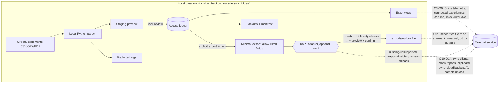

# PerFin local privacy boundary

Task 1c ([#4](https://github.com/NicoLeeVaz/PerFin/issues/4)), part of tracker [#1](https://github.com/NicoLeeVaz/PerFin/issues/1). Specification version **privacy-boundary/1.0.0**, 2026-11-04.

Related: [NoPii export contract](nopii-export-contract.md) · [test checklist](test-checklist.md) · machine-readable defaults [`config/privacy/defaults.json`](../../config/privacy/defaults.json) · reference checks [`config/privacy/perfin_privacy_checks.py`](../../config/privacy/perfin_privacy_checks.py).

## Status and what this document is not

- This is a specification plus small, Linux-tested reference functions. **No privacy guarantee is asserted.** A behaviour counts as verified only when the matching row in the [test checklist](test-checklist.md) has passed on the stated environment. Every Windows, Office and Access runtime check is currently **pending**.
- Statements about Microsoft product behaviour are labelled **[Unverified]** where this session could not reach `learn.microsoft.com` or `support.microsoft.com` (blocked by network policy). The two Microsoft claims carried over from [research/local-architecture.md](../../research/local-architecture.md) (Python in Excel and Office Scripts need the cloud) were cited there from primary sources; they were not re-fetched here.
- PerFin can control its own code. It cannot control Office, Windows, add-ins or sync clients. Those parts are listed as **residual risks** with recommended settings, not as guarantees.

## Principles

1. **Local by default.** Ordinary use (import, review, commit to Access, reconcile, refresh Excel, back up, restore) works with no network connection and makes no outbound calls.
2. **No PerFin network code in the default workflow.** PerFin ships no telemetry, update check, cloud parser, bank connection, payment execution or AI client. Python and VBA code must not open sockets or HTTP connections (see the static checks in the [checklist](test-checklist.md)).
3. **One authoritative store.** Access is the ledger. Excel is a refreshed view. Exports are copies, never a second ledger.
4. **Real data never enters the public repository.** Only code, empty templates and synthetic fixtures are committed.
5. **Every outbound path is disabled by default** and is listed in the [data-flow table](#data-flow-and-outbound-paths). A path not in the table is a defect.
6. **Fail closed.** If a safeguard (sync-folder check, NoPii adapter, fidelity check, redaction) is missing or fails, the dependent action is disabled. PerFin never falls back to the raw data.

## User data directory

### Default location

| Platform | Default data root | Notes |
| --- | --- | --- |
| Windows (production) | `%LOCALAPPDATA%\PerFin` | `%LOCALAPPDATA%` is per-user and not part of roaming profiles. OneDrive Known Folder Move redirects Desktop, Documents and Pictures (and optionally other user folders), not `AppData\Local` [Unverified]. Do not use `%APPDATA%` (Roaming), which can roam with a domain profile [Unverified]. |
| Linux/macOS (development only) | `$XDG_DATA_HOME/perfin`, else `~/.local/share/perfin` | Synthetic data only. A Linux run is never evidence for Windows behaviour. |

An override is accepted from `PERFIN_DATA_DIR` or the user settings file `<data root>\config\settings.json`. Overrides get the same checks as the default. The checkout check walks both the literal path and its symlink-resolved path, so an alias into a checkout is refused. The settings file lives in the data root, never in the checkout.

### Layout

| Subfolder | Contents | Sensitivity |
| --- | --- | --- |
| `statements\originals\` | Original CSV/OFX/PDF statements, kept unchanged, named by SHA-256 plus a user alias (no account numbers in file names) | High; original PDFs are never sanitized |
| `db\` | Access back end (`.accdb`) and its lock file | High; authoritative ledger |
| `workbooks\` | The user's populated Excel front end(s) | High |
| `staging\` | Parsed preview rows awaiting review | High; deleted after commit or expiry |
| `exports\outbox\` | Scrubbed exports the user explicitly created | Still sensitive (see the [NoPii contract](nopii-export-contract.md)) |
| `backups\` | Backup sets with a hash manifest | High |
| `logs\` | Redacted diagnostic logs | Medium after redaction |
| `temp\` | PerFin working files | High; cleared at the end of each run and at startup |
| `config\` | `settings.json` and local import profiles | Low to medium |

A marker file `perfin-data-dir.json` records `{"kind": "real" | "synthetic", "created": "YYYY-MM-DD"}`. Test suites and fixture generators refuse to write to, or read from, a `real` directory. The application refuses to run its demo/synthetic mode against a `real` directory.

### Location checks (run at first setup, at each start-up and before each backup)

| Condition | Decision |
| --- | --- |
| Data root, or any backup/export target, is inside a Git working tree (an ancestor contains `.git`) | **Refuse.** No override. |
| Path contains a known sync-client segment (`OneDrive`, `OneDrive - <org>`, `Dropbox`, `Google Drive`, `My Drive`, `GoogleDrive`, `iCloudDrive`, `iCloud Drive`, `Mobile Documents`, `Box`, `Box Sync`, `pCloud Drive`, `Nextcloud`, `ownCloud`, `MEGA`, `SynologyDrive`, `Sync`), or lies under the folder named in the `OneDrive`, `OneDriveConsumer` or `OneDriveCommercial` environment variables | **Warn and block** until the user explicitly acknowledges. The acknowledgement is stored in `settings.json` with the date and path, and is invalidated if the path changes. |
| UNC/network path (`\\server\share`) or a mapped network drive | Warn and block until acknowledged. |
| Path is under a user folder that may be redirected (`Desktop`, `Documents`, `Pictures`) | Warn; the user should confirm that Known Folder Move or other backup sync is off for that folder. |

The detector is a heuristic. It cannot see virtual drive letters (for example a Google Drive for desktop mount letter), Windows "File History"/OneDrive PC folder backup settings or third-party backup agents. The checklist therefore keeps a manual check on the real computer. Reference implementation: `evaluate_data_dir()` in [`perfin_privacy_checks.py`](../../config/privacy/perfin_privacy_checks.py); markers live in `defaults.json` → `data_dir.sync_markers`.

### Synthetic versus real data

| | Synthetic fixtures | Real data |
| --- | --- | --- |
| Location | `fixtures/**` and test temporary directories inside the repository's test runs | Data root only |
| Committed to Git | Yes | Never |
| Marker | `perfin-data-dir.json` kind `synthetic` for generated directories; fixture files state "synthetic" in a header row, comment or adjacent README | kind `real` |
| Card/account numbers | Public test numbers only (for example `4111 1111 1111 1111`) or obviously fake identifiers | Never stored in full by PerFin (alias plus at most last four digits) |

The repository scan `scan_repo_for_forbidden()` flags real-data file types outside allowed paths and Luhn-valid card numbers that are not known public test numbers. Wiring it into a hook or release check belongs to tasks 3a/5a.

## Offline operation

The default workflow uses only:

- local files in the data root;
- installed Python run as a normal local process, using the standard library plus pinned packages installed beforehand (package installation is a set-up step with network access but no financial data);
- desktop Excel and Access with VBA, DAO/ADO/ODBC and Power Query Desktop against **local** sources only.

Not used, and not required by any PerFin feature:

| Feature | Reason |
| --- | --- |
| Python in Excel | Runs in Microsoft's cloud and needs internet (cited in [research/local-architecture.md](../../research/local-architecture.md)). |
| Office Scripts | Requires internet and connected experiences; scripts are stored in cloud storage (cited in [research/local-architecture.md](../../research/local-architecture.md)). |
| Copilot / AI features in Office | Content is processed by an online service [Unverified]. Not part of PerFin. |
| Office connected experiences that analyse content (for example Analyze Data/Ideas, Editor, Translator, Designer) | Content is sent to Microsoft online services for analysis [Unverified]. |
| Cloud document parsing, OCR services, bank aggregators, payment APIs | Out of scope. |
| Power Query web or online sources (`Web.Contents`, SharePoint, online connectors) | Not allowed in PerFin queries. |

## Data flow and outbound paths

Every dotted line is an outbound path. Each one is disabled by default. Paths O1 and O2 are the only ones PerFin itself creates; the rest belong to the platform and are controlled by settings PerFin documents and checks where it can.

| ID | Outbound path | Default | Who controls it | Requirement / mitigation | Verification |
| --- | --- | --- | --- | --- | --- |
| O1 | Scrubbed export for external AI, via NoPii adapter | **Disabled.** Feature flag off; also needs a supported adapter and a per-export confirmation | PerFin | [NoPii contract](nopii-export-contract.md): explicit action, scrubbed preview, money/date fidelity checks, writes only to `exports\outbox`. PerFin never transmits; the user moves the file. | Linux unit tests for gate logic; Windows UI test pending |
| O2 | Raw/unscrubbed export to external AI, or fallback when the adapter is missing | **Prohibited.** No setting enables it | PerFin | Missing, unsupported or failing adapter = export disabled. | Unit test `test_missing_adapter_disables_export` |
| O3 | PerFin telemetry, update checks, error reporting | **None exists** | PerFin | No network imports or calls in PerFin Python/VBA. | Static scan; offline run (pending) |
| O4 | Office diagnostic data | Platform default is on at a "required" level [Unverified] | Office/admin policy | Set to the lowest level available (privacy settings or the "diagnostic data" policy) [Unverified]. Residual risk documented. | Manual, pending |
| O5 | Office connected experiences (content analysis, online content downloads, optional experiences) | Platform default may be on [Unverified] | Office privacy settings / policy | Turn off experiences that analyse content and optional connected experiences; PerFin features must work with all of them off [Unverified]. | Manual, pending |
| O6 | Python in Excel, Office Scripts, Copilot | Not used | User/Office | No PerFin feature uses them; workbooks contain no `=PY()` cells or scripts. | Workbook inspection, pending |
| O7 | Add-ins (COM, VSTO, Office web add-ins) | PerFin ships none | User | Inventory installed add-ins; web add-ins can reach the network and read workbook content they are granted [Unverified]. Disable non-essential add-ins for PerFin workbooks. | Manual, pending |
| O8 | Macros (VBA) | PerFin VBA has no network calls | PerFin | Forbid `MSXML2.XMLHTTP`, `WinHttp`, `URLDownloadToFile`, `InternetOpen`, `Shell`/`CreateObject("WScript.Shell")` launching network tools, `FollowHyperlink`, mail objects. Sign or review macros; keep macro settings restrictive [Unverified]. | Static scan of exported VBA (2b/2c), pending |
| O9 | External links, data connections, Power Query, hyperlinks, linked images | No web sources; only local Access/file sources | PerFin + Excel Trust Center | Power Query sources limited to the data root; no links to other workbooks; external-content prompts left enabled [Unverified]. | Connection inventory in workbook, pending |
| O10 | OneDrive/SharePoint AutoSave, sync clients (OneDrive, Dropbox, Google Drive, iCloud, others), Known Folder Move | Data root outside synced folders | PerFin check + user | Location checks above; AutoSave off for PerFin files [Unverified]. | Unit tests for detector; real-machine check pending |
| O11 | Crash reports (Office, Windows Error Reporting), which may include memory with workbook content [Unverified] | Platform default | Windows/Office | Lowest diagnostic level; no automatic dump submission where policy permits [Unverified]. Residual risk. | Manual, pending |
| O12 | Clipboard history and cross-device clipboard sync | Platform setting | Windows | Recommend turning off cloud clipboard sync [Unverified]. PerFin never copies data to the clipboard automatically. | Manual, pending |
| O13 | Cloud backup of the data root or backups (OneDrive PC backup, third-party backup agents, network File History) | Off for the data root | User | Backups go to `backups\` or user-chosen offline media; a cloud or network destination needs an encrypted container and explicit acknowledgement. | Manual, pending |
| O14 | Antivirus cloud sample submission (for example Microsoft Defender automatic sample submission) | Platform default [Unverified] | Windows | Residual risk; consider "prompt before sending" for files [Unverified]. | Manual, pending |
| O15 | Git commits/pushes of the public repository | Synthetic only | Contributors | Data root never inside a checkout; repository scan; fixtures marked synthetic. | `scan_repo_for_forbidden()` run on this branch |
| O16 | Manual sharing (email, chat, printing to cloud printers, "Share" button) | User action only | User | Out of PerFin's control; README warns. PerFin has no share/send feature. | n/a |

Local-only stores that are still inside the threat boundary because they retain data or metadata:

| Local store | Risk | Requirement |
| --- | --- | --- |
| Office AutoRecover and backup copies (location configured in Excel/Access options [Unverified]) | Full copies of workbook content outside the data root | Keep AutoRecover on for safety, but ensure its folder is local and not synced; include it in the retention review. |
| Office temp and owner/lock files (`~$name.xlsx`, `.laccdb`) and `%TEMP%` | Partial content, user name | PerFin writes its own temp files only to `<data root>\temp`; clears them at end of run and at start-up. |
| Recent-files lists, jump lists, Office MRU (may roam with a signed-in Microsoft account [Unverified]) | Reveal file names and paths | File names carry aliases and hashes only, never account numbers or names. |
| Windows Search index | Indexed text of statements | Optional: exclude the data root from indexing [Unverified]. |
| Python `__pycache__`, tracebacks | Tracebacks may contain row values | Catch parsing errors and log row number, field and error code, not the value. |
| Clipboard (local) | Last copied cells | User awareness; no automatic copy. |

## Encryption versus protection

| Mechanism | What it is | What it is not |
| --- | --- | --- |
| BitLocker / Windows device encryption | Whole-volume encryption at rest for a lost or stolen device [Unverified edition availability] | No protection from software running as the signed-in user, or after a file leaves the volume |
| EFS | Per-file/folder encryption tied to the Windows account [Unverified edition availability] | Lost if the certificate is lost; copies to non-NTFS media may be decrypted |
| Encrypted container (for example a VeraCrypt volume or AES-256 archive) | Protects backup sets on removable or cloud media | Not mounted means not usable; key management is the user's job |
| Excel/Access "Encrypt with Password" | File encryption with a password [Unverified algorithm details] | Not recoverable without the password |
| Worksheet protection, workbook structure protection, locked cells, hidden sheets | Prevents accidental edits | **Not encryption and not a security control.** The data stays readable. |

PerFin recommends device encryption plus an encrypted container for any backup that leaves the computer. It never describes sheet protection as protection of privacy.

## Retention

| Item | Default retention | Notes |
| --- | --- | --- |
| Original statements | Kept until the user deletes them | Needed to reproduce reconciliations; restore needs them or their hashes |
| Access ledger and audit trail | Kept | Authoritative record |
| Staging files | Deleted on commit or rejection of the batch; otherwise after 30 days | Import batch metadata (hash, counts) stays in Access |
| `exports\outbox` | Deleted after 7 days; the user can delete sooner | Export manifest (id, date, record count, adapter version, hashes) is kept in the audit trail, without content |
| Diagnostic logs | Rotated; deleted after 90 days; maximum 10 MB per file | Redacted (below) |
| `temp\` | Cleared at end of each run and at start-up | |
| Backups | Last 7 daily, last 12 monthly | User may keep more on offline media |
| Office AutoRecover | Office manages it [Unverified] | Manual review at retention checks |

Deletion is ordinary file deletion. Secure erase is not promised on SSDs; device encryption is the mitigation.

## Backup and restore

1. Create a backup only when no process holds the Access database open (no `.laccdb` lock file), or by using Access's own compact/backup feature [Unverified procedure name]. Never copy a database while it is being written.
2. A backup set contains the database, original statements (or their SHA-256 references if stored separately), local import profiles, `settings.json` and a `manifest.json` listing each file's relative path, size and SHA-256 hash, the PerFin version, and the contract versions.
3. Backup destinations get the same location checks as the data root. Destinations inside a checkout are refused; synced, network or removable destinations require acknowledgement and an encrypted container.
4. Restore into an empty data root, verify every manifest hash, open Access, and confirm that reconciled balances, import identities and statement history match the values recorded at backup time (3a acceptance scenario). A restore that fails a hash check stops before writing.
5. Restore tests use synthetic data in CI-like runs; the real-machine restore test is pending until 3a/5a.

## Logs and audit-log redaction

Two different records:

- **Ledger audit trail** (inside Access, 2b): the authoritative edit history. It contains values because it is part of the ledger. It has the same protection as the database and is never written to log files or exports.
- **Diagnostic logs** (`<data root>\logs`): for troubleshooting. They must not contain financial content.

Diagnostic log rules (machine-readable in `defaults.json` → `log_redaction`):

1. Structured events with allow-listed fields only: timestamp, level, event code, import batch id, row number, field name, counts, durations, file SHA-256, contract/profile versions and error codes.
2. Never log: descriptions/payees/memos, amounts, balances, full or partial account or card numbers, names, addresses, email addresses, phone numbers, raw CSV lines, PDF text, exception messages that embed values, or the user's profile path.
3. Paths are logged relative to the data root (`<data>\staging\...`); the user-profile part is replaced with `%USERPROFILE%`.
4. A regex backstop runs on every message before it is written: Luhn-valid 13 to 19 digit sequences → `[REDACTED-PAN]`; other runs of 6 or more digits → `[REDACTED-DIGITS]`; email → `[REDACTED-EMAIL]`; US SSN pattern → `[REDACTED-SSN]`; IBAN-like strings → `[REDACTED-IBAN]`; user profile paths → `%USERPROFILE%`. The backstop is a safety net, not the main control.
5. Debug logging that includes values is not provided.

Reference implementation: `redact_log_text()`.

## Spreadsheet formula injection

Imported text (descriptions, payees, memos, categories typed by the user, file names) is data, never a formula.

- **Storage:** Access stores the original text unchanged.
- **Excel output:** text fields are written as text cells (string type and the `@` text number format, or Power Query typed text columns). A text value that begins with `=`, `+`, `-`, `@`, tab (`\t`) or carriage return (`\r`) is additionally prefixed with a single quote `'` when it is written in a way Excel could evaluate. As a conservative extension, line feed and the full-width forms `＝ ＋ － ＠` are treated the same, and so is any value whose first non-space character is a trigger.
- **CSV/TSV export** (including NoPii outbox files): the same prefix rule applies to every text field. Numeric amount columns are written as integer minor units and are not prefixed, so a negative amount stays a number. A text column must never contain a number formatted as text that begins with `-` without the prefix.
- The prefix is a display/export transformation only. It is not written back to Access.

Reference implementation: `escape_spreadsheet_text()` and `needs_formula_escape()`. Whether Excel and Power Query treat these values as inert on the user's version is a pending Windows check.

## Assumptions to reconcile at the Wave 1 gate

- Money is integer minor units (`amount_minor`, signed integer) with an ISO 4217 `currency`; dates are ISO `YYYY-MM-DD`. The field names used in the NoPii envelope are provisional and must be aligned with the 1a contract (`contracts/**`).
- Import batch ids, transaction ids and file SHA-256 identity are assumed to exist in the 1a contract; diagnostic logs refer to them.
- The data-root layout and `perfin-data-dir.json` marker are proposed here; 2a/2b/3a implement them.
- The ledger audit trail is assumed to be an Access table owned by 2b.
